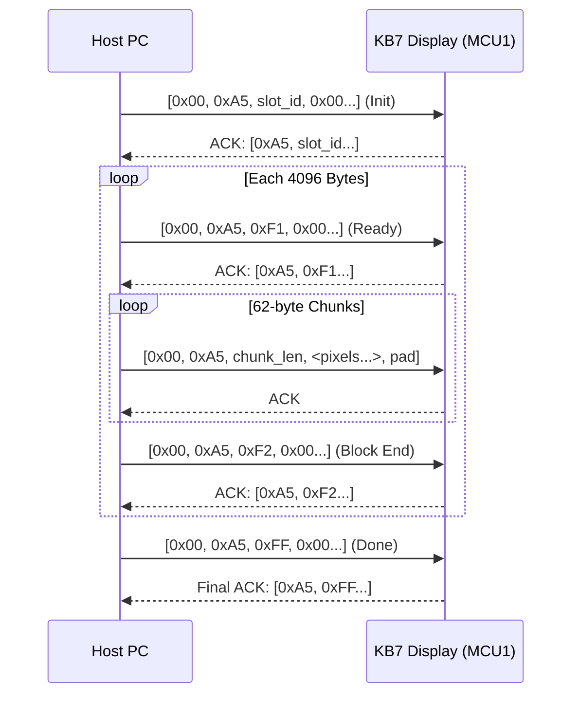

# Turtle Beach Command Series KB7 - Touch Display Reverse Engineering & USB HID Driver

This repository contains the complete reverse-engineered **USB HID protocol documentation** and an **open-source Python driver** for the integrated 4.3" touch display on the **Turtle Beach Command Series KB7** mechanical gaming keyboard.

---

## 🌟 Key Findings Summary

* **Device Identification:** USB Vendor ID `0x10F5` (Turtle Beach / Roccat), Product ID `0x5038`.
* **Hardware Architecture:** Dual-MCU system:
  * **MCU 1 (Display/Host):** Sonix SNC73xx ARM microcontroller running embedded **LVGL** (Light and Versatile Graphics Library) connected to the 4.3-inch touch screen.
  * **MCU 2 (Analog Matrix):** Artery AT423 / AT32F423 dedicated to magnetic Hall-effect switch scanning (0.1mm - 3.2mm rapid trigger) at 8,000 Hz.
* **Display Specifications:** 4.3" Color TFT LCD, **800 × 480 WVGA**, 16-bit **RGB565 Little-Endian** color format.
* **Display Endpoint:** Interface `mi_01` (Usage Page `0xFF00`, Usage `0x0001`), 65-byte USB HID Output Reports.
* **Touch Endpoint:** Interface `mi_02`, Collection `COL04` (Usage Page `0xFF02`, Usage `0x0001`), 12-byte USB HID Input Reports.

---

## 🗺️ USB HID Interface Map

| Interface | Collection | Usage Page | Usage | Function |
| :--- | :--- | :--- | :--- | :--- |
| **`mi_00`** | - | `0xFF90` | `0xFF00` | Sonix bootloader ISP & low-level hardware control |
| **`mi_01`** | - | `0xFF00` | `0x0001` | **Display Streaming & Image Control (LCD)** |
| **`mi_02`** | `COL01` | `0x000C` | `0x0001` | Consumer Media Keys (Volume, Play/Pause) |
| **`mi_02`** | `COL02` | `0x0001` | `0x0080` | System Control (Power / Sleep) |
| **`mi_02`** | `COL03` | `0xFF01` | `0x0001` | Hardware Telemetry & Knob Stream |
| **`mi_02`** | `COL04` | `0xFF02` | `0x0001` | **Touchscreen Multi-Touch & Gesture Digitizer** |
| **`mi_02`** | `COL05` | `0x0001` | `0x0006` | Macro & Extended Keys |
| **`mi_02`** | `COL06` | `0xFF03` | `0x0001` | RGB Lighting & Actuation Configuration (1,044B Feature Report) |
| **`mi_03`** | - | `0x0001` | `0x0006` | Primary Keyboard (8,000 Hz report rate) |

---

## 📊 LCD Streaming Protocol Specification (`mi_01`)

To update the 800×480 screen:
1. **Initialize (`0xA5`)**: Send Output Report with slot index (`0x00` = full background, `0x41+n` = custom widget icon).
2. **Block Loop (4096-byte segments)**:
   * **Ready (`0xF1`)**: Send packet `[0x00, 0xA5, 0xF1, ...]` and await ACK.
   * **Data Chunks**: Stream up to 62-byte slices: `[0x00, 0xA5, chunk_size, data[0..chunk_size-1], 0x00...]`.
   * **Block Finish (`0xF2`)**: Send packet `[0x00, 0xA5, 0xF2, ...]` and await ACK.
3. **Finalize (`0xFF`)**: Send packet `[0x00, 0xA5, 0xFF, ...]` to trigger screen refresh.



---

## 🚀 Quick Start & Usage

### 1. Inspect Connected Endpoints
```bash
python -m turtlebeach_kb7.cli info
```

### 2. Screen Brightness, Timeout & Page Control
```bash
# Query current LCD settings (Brightness, Sleep Timeout, Dim Timeout, Active Page)
python -m turtlebeach_kb7.cli brightness

# Set brightness to 80% (0-100)
python -m turtlebeach_kb7.cli brightness 80

# Set screen sleep timeout in seconds (e.g. 120s)
python -m turtlebeach_kb7.cli timeout 120

# Switch active display page (1 to 5)
python -m turtlebeach_kb7.cli page 2

# List configured virtual screen keys on the display
python -m turtlebeach_kb7.cli keys
```

### 3. Display Widget Management & Layout Templates
```bash
# Inspect all configured widget slots across pages (with catalog names)
python -m turtlebeach_kb7.cli slots

# Filter slots on a specific page (e.g. Page 1)
python -m turtlebeach_kb7.cli slots --page 1

# List all factory layout templates (numpad, telemetry, productivity, multimedia, gaming, cs2, obs)
python -m turtlebeach_kb7.cli templates

# Apply a layout template to a display page
python -m turtlebeach_kb7.cli template telemetry --page 2

# Assign an individual widget (e.g. CPU Load AppID 1006) to Page 1, Slot 0
python -m turtlebeach_kb7.cli assign 1 0 1006
```

### 4. Stream a Custom Wallpaper
```bash
# Upload any PNG/JPG/BMP image (automatically scaled and formatted to 800x480 RGB565)
python -m turtlebeach_kb7.cli upload my_wallpaper.png

# Or upload a synthetic color gradient test pattern
python -m turtlebeach_kb7.cli upload --test-pattern
```

### 5. Monitor Real-Time Touch Events
```bash
python -m turtlebeach_kb7.cli touch
```

Output:
```text
[*] Listening for touch events on 4.3" display (Ctrl+C to stop)...
Touch Event: Type=0x33 | Gesture=down | Slot= 1 | Coord=(400, 240) | Raw=3301019001f0000000000000
Touch Event: Type=0x33 | Gesture=move | Slot= 1 | Coord=(412, 245) | Raw=3302019c01f5000000000000
Touch Event: Type=0x33 | Gesture=up   | Slot= 1 | Coord=(412, 245) | Raw=3300019c01f5000000000000
```

### 6. Background Daemon & Custom Plugin SDK
To avoid USB bus contention and keyboard freezes, launch the single-writer daemon:
```bash
# Start background hardware daemon (TCP 127.0.0.1:27878)
python -m turtlebeach_kb7.cli daemon
```
Custom plugins can connect via the client SDK to assign widgets and subscribe to touch gestures:
```bash
python examples/plugin_interactive_touch.py
```
For complete daemon IPC specification and plugin creation guide, see [`docs/DAEMON_API.md`](docs/DAEMON_API.md).

### 7. Universal Windows Sound Display & Audio Mixer
Replaces the missing/broken Swarm II sound mixer and Windows 11 hidden controls with full per-app volume sliders across all audio endpoints (including SteelSeries Sonar, Voicemeeter, and USB headsets):
```bash
# Launch Dark Mode Desktop Audio Mixer (with KB7 Knob / Touch synchronization)
python -m turtlebeach_kb7.cli mixer

# Or inspect and control volume via terminal
python -m turtlebeach_kb7.cli mixer --cli
python -m turtlebeach_kb7.cli mixer --cli --set-app Discord --volume 80
```
For architecture analysis and SDK guide, see [`docs/AUDIO_MIXER.md`](docs/AUDIO_MIXER.md).

### 8. Procedural Theme & HUD Designer
Generate and upload high-resolution, pixel-perfect 800×480 custom UI designs and HUD wallpapers tailored to the KB7 display:
```bash
# List available procedural theme presets
python -m turtlebeach_kb7.cli theme --list

# Render and upload the Sci-Fi Tactical Cockpit theme
python -m turtlebeach_kb7.cli theme tactical_hud

# Other themes:
python -m turtlebeach_kb7.cli theme audiophile_dark   # Studio console & analog VU meters
python -m turtlebeach_kb7.cli theme neon_cyberpunk    # Synthwave / Cyberdeck with perspective grid
```

---

## 🐍 Python Library Example

```python
from turtlebeach_kb7.device import KB7Device, SLOT_BACKGROUND
from turtlebeach_kb7.image import convert_to_rgb565

with KB7Device() as kb7:
    # 1. Query & adjust display settings
    settings = kb7.get_lcd_settings()
    print(f"Current brightness: {settings.brightness}%, Active page: {settings.active_page}")
    kb7.set_brightness(90)
    kb7.set_active_page(1)

    # 2. Upload custom background wallpaper (800x480 RGB565)
    rgb565_data = convert_to_rgb565("custom_screen.png", width=800, height=480)
    kb7.upload_image(rgb565_data, slot_id=SLOT_BACKGROUND)
    print("Screen successfully updated!")
```

See [`examples/control_screen_settings.py`](examples/control_screen_settings.py) for a complete interactive demonstration.

---

## 📚 Detailed Documentation
* [`docs/AUDIO_MIXER.md`](docs/AUDIO_MIXER.md): Universal Windows Sound Display, per-app WASAPI control, and KB7 knob integration.
* [`docs/DAEMON_API.md`](docs/DAEMON_API.md): Single-writer hardware daemon, JSON-over-TCP IPC protocol, and plugin SDK.
* [`docs/PROTOCOL.md`](docs/PROTOCOL.md): Complete USB HID packet specifications, timings, and error states.
* [`docs/HARDWARE.md`](docs/HARDWARE.md): Deep-dive into the Sonix SNC73xx + Artery AT423 dual-MCU architecture.
* [`docs/INTERFACES.md`](docs/INTERFACES.md): Detailed breakdown of all 9 HID endpoints and report descriptor parameters.

---

## ⚖️ License
Released under the MIT License.
