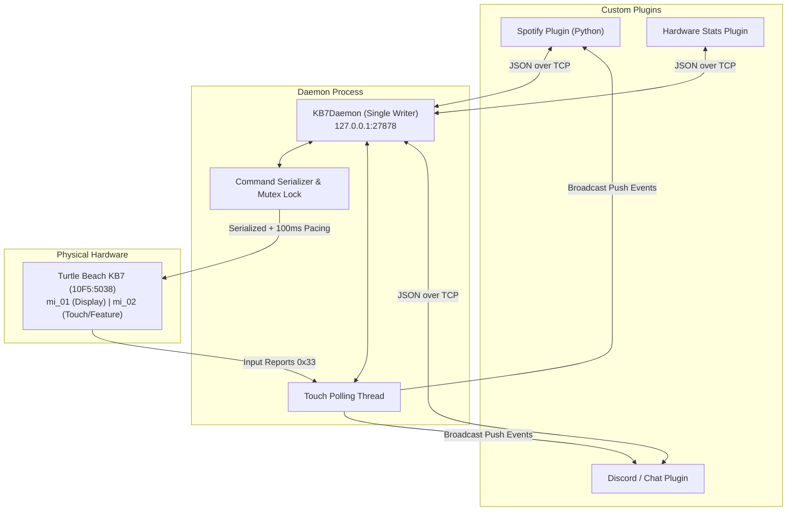

# Turtle Beach KB7 - Daemon Architecture & Plugin SDK

## 1. Problem Overview & Root Cause Analysis

When communicating with the Turtle Beach Command Series KB7 over raw USB HID, two key factors can cause the keyboard's LCD controller (Sonix SNC73xx) or Hall-effect scanning MCU (Artery AT423) to freeze:

1. **Endpoint Collisions (Concurrent Writers)**:
   * The official software (**Turtle Beach Swarm II**) runs multiple high-frequency background loops (~33 Hz RGB streaming, ~33 Hz telemetry polling, blocking touch digitizer reads).
   * If an external script simultaneously opens the HID handles and sends requests, USB packets become **interleaved**. The microcontroller's state machine stalls waiting for expected bytes or ACKs, eventually resulting in Win32 `ERROR_SEM_TIMEOUT` (Error 121) and a hardware freeze.
2. **Missing Inter-Packet Pacing**:
   * Flash/EEPROM updates (such as Report `0x35` slot configurations or Report `0x25` LCD settings) require a **100 ms pacing delay** between consecutive feature packets. Without this delay, internal buffers overflow.

---

## 2. Solution: The Single-Writer Daemon (`KB7Daemon`)

To prevent freezes and provide a stable platform for custom plugins, the driver includes a centralized background service: **`KB7Daemon`**.



### Key Responsibilities of `KB7Daemon`:
* **Exclusive Hardware Ownership**: Only the daemon opens USB handles.
* **Strict Serialization**: Commands are processed sequentially with guaranteed 100 ms delays.
* **Pub/Sub Touch Broadcasting**: Automatically reads Report `0x33` digitizer events and broadcasts them in real time to all connected plugins.
* **Language-Agnostic Protocol**: Lightweight line-delimited JSON over localhost TCP socket (`127.0.0.1:27878`), accessible from Python, Node.js, C#, Go, or Rust.

---

## 3. Starting the Daemon

```bash
# Start daemon in foreground
python -m turtlebeach_kb7.cli daemon

# Or bind to custom host/port
python -m turtlebeach_kb7.cli daemon --host 127.0.0.1 --port 27878
```

> [!IMPORTANT]
> Ensure **Turtle Beach Swarm II** is closed before launching `KB7Daemon` to prevent USB bus contention.

---

## 4. Writing Plugins with `KB7Client` (Python SDK)

Creating a custom plugin requires only a few lines of Python:

```python
import time
from turtlebeach_kb7.client import KB7Client
from turtlebeach_kb7.widgets import APP_CPU_USAGE, APP_PLAY_PAUSE

with KB7Client() as client:
    # 1. Adjust screen brightness
    client.set_brightness(85)

    # 2. Assign custom widgets to Page 1
    client.assign_widget(page=1, slot=0, app_id=APP_CPU_USAGE)
    client.assign_widget(page=1, slot=1, app_id=APP_PLAY_PAUSE)

    # 3. Register reactive touch callbacks
    @client.on_touch(slot=0, gesture="tap")
    def on_cpu_tapped(event):
        print(f"CPU widget tapped at ({event['x']}, {event['y']})!")

    @client.on_touch(slot=1, gesture="tap")
    def on_media_tapped(event):
        print("Toggling media playback!")

    # Keep plugin running
    while True:
        time.sleep(1)
```

---

## 5. IPC Protocol Reference (JSON-over-TCP)

Plugins connect to `127.0.0.1:27878` and send newline-terminated (`\n`) JSON requests.

### Commands

#### 1. Ping
* **Request:** `{"cmd": "ping", "req_id": 1}`
* **Response:** `{"status": "ok", "message": "pong", "time": 1730936000.0, "req_id": 1}`

#### 2. Set Brightness
* **Request:** `{"cmd": "set_brightness", "value": 80, "req_id": 2}`
* **Response:** `{"status": "ok", "brightness": 80, "req_id": 2}`

#### 3. Set Display Page
* **Request:** `{"cmd": "set_page", "page": 2, "req_id": 3}`
* **Response:** `{"status": "ok", "active_page": 2, "req_id": 3}`

#### 4. Assign Widget to Slot
* **Request:** `{"cmd": "assign_widget", "page": 1, "slot": 0, "app_id": 1006, "req_id": 4}`
* **Response:** `{"status": "ok", "page": 1, "slot": 0, "app_id": 1006, "name": "CPU Load", "req_id": 4}`

#### 5. Apply Predefined Template
* **Request:** `{"cmd": "apply_template", "page": 1, "name": "telemetry", "req_id": 5}`
* **Response:** `{"status": "ok", "page": 1, "template": "telemetry", "req_id": 5}`

#### 6. Subscribe to Touch Events
* **Request:** `{"cmd": "subscribe", "req_id": 6}`
* **Response:** `{"status": "ok", "message": "Subscribed to touch events", "req_id": 6}`
* **Push Event Broadcast:**
  ```json
  {"event": "touch", "data": {"event_type": 51, "gesture": "tap", "slot_id": 0, "x": 402, "y": 241, "raw": "3303009201f100..."}}
  ```
