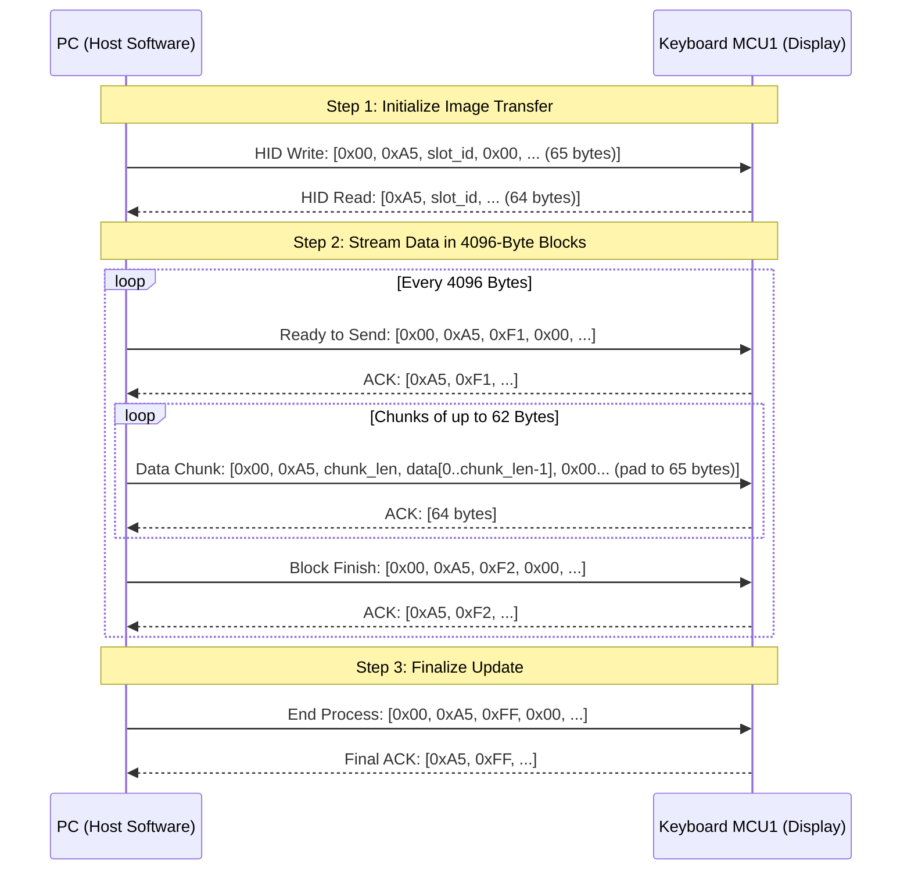
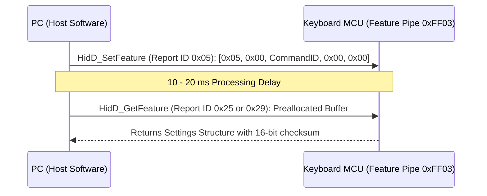

# Turtle Beach Command Series KB7 - USB HID Protocol Specification

## 1. Device Identification & USB Architecture

* **Vendor ID (VID):** `0x10F5` (Turtle Beach / Roccat)
* **Product ID (PID):** `0x5038` (Command Series KB7 Keyboard)
* **USB Hub PID:** `0x503D` (Integrated high-speed USB hub)
* **Storage Mode PID:** `0x5037` (USB Mass Storage for firmware / asset storage)

### Dual-MCU Hardware Architecture
The Turtle Beach KB7 utilizes two microcontrollers to separate real-time gaming input from high-resolution display rendering:
1. **MCU 1 (Display & USB Controller):**
   * **Chipset:** Sonix SNC7320A (High-speed USB 2.0 + LCD Controller)
   * **Firmware:** `KB7_V1.39.bin`
   * **Graphics Engine:** Embedded **LVGL v9** (Light and Versatile Graphics Library)
   * **Panel:** 4.3-inch Capacitive Color Touch Display, 800 × 480 WVGA resolution
2. **MCU 2 (Analog Matrix & Hall Effect Switches):**
   * **Chipset:** Artery AT423 / AT32F423 (`AP_AT423_V1.15.bin`)
   * **Function:** High-frequency polling (up to 8,000 Hz), magnetic Hall-effect actuation point scanning, Rapid Trigger, and SOCD resolution.

---

## 2. USB HID Interface Map

| Interface | Collection | Usage Page | Usage | In/Out/Feature Length | Function |
| :--- | :--- | :--- | :--- | :--- | :--- |
| **`mi_00`** | - | `0xFF90` | `0xFF00` | 65 / 65 / 65 bytes | Sonix bootloader ISP & low-level hardware control |
| **`mi_01`** | - | `0xFF00` | `0x0001` | 65 / 65 / 0 bytes | **Display Protocol & Image Data Streaming (LCD)** |
| **`mi_02`** | `COL01` | `0x000C` | `0x0001` | 4 / 0 / 0 bytes | Consumer Media keys (Play, Pause, Vol+, Vol-) |
| **`mi_02`** | `COL02` | `0x0001` | `0x0080` | 2 / 0 / 0 bytes | System Control (Power, Sleep, Wake) |
| **`mi_02`** | `COL03` | `0xFF01` | `0x0001` | 8 / 0 / 0 bytes | Custom Hardware Event Stream 1 |
| **`mi_02`** | `COL04` | `0xFF02` | `0x0001` | 12 / 0 / 0 bytes | **Touch Screen Input & Widget Interaction Events** |
| **`mi_02`** | `COL05` | `0x0001` | `0x0006` | 21 / 0 / 0 bytes | Extra keyboard scan codes / Macro execution |
| **`mi_02`** | `COL06` | `0xFF03` | `0x0001` | 0 / 0 / 1044 bytes | **LCD Settings, Brightness, Keys & Profiles (Feature Report)** |
| **`mi_03`** | - | `0x0001` | `0x0006` | 9 / 2 / 0 bytes | Primary Standard HID Keyboard (8000 Hz polling) |

---

## 3. Display Control & Image Streaming Protocol (`mi_01`)

Communication with the touch display is executed over interface `mi_01` (UsagePage `0xFF00`, Usage `0x0001`).
All packets use **65-byte HID Output Reports** (Byte 0 is Report ID `0x00`, followed by 64 bytes of payload).
The host reads back **64-byte HID Input Reports** as acknowledgments.

### 3.1 Display Frame Specifications
* **Screen Resolution:** 800 × 480 pixels
* **Color Depth:** 16-bit **RGB565** Little-Endian
* **Byte Order:**
  $$\text{pixel}_{16} = ((R \text{ \& } 0\text{xF8}) \ll 8) \mid ((G \text{ \& } 0\text{xFC}) \ll 3) \mid (B \gg 3)$$
  * Byte 0: `pixel & 0xFF` (Low byte)
  * Byte 1: `(pixel >> 8) & 0xFF` (High byte)
* **Total Background Payload Size:** $800 \times 480 \times 2 = 768{,}000\text{ bytes}$

### 3.2 Protocol Sequence Flow

### 3.3 Packet Definitions

#### 1. Start Image Update Command
* **Host Output Report (65 bytes):**
  * `[0]` = `0x00` (Report ID)
  * `[1]` = `0xA5` (Magic command byte)
  * `[2]` = `slot_id`:
    * `0x00`: Full background wallpaper ($800 \times 480$)
    * `0x40`: Scaled background
    * `0x41 + n`: Custom widget icon for slot $n$ ($0 \le n \le 15$)
  * `[3..64]` = `0x00` (Padding)
* **Device Response (64 bytes):**
  * `[0]` = `0xA5`
  * `[1]` = `slot_id` (Echo of command)

#### 2. Ready to Start Block Command (`0xF1`)
* **Host Output Report (65 bytes):**
  * `[0]` = `0x00`, `[1]` = `0xA5`, `[2]` = `0xF1`, `[3..64]` = `0x00`
* **Device Response (64 bytes):**
  * `[0]` = `0xA5`, `[1]` = `0xF1`

#### 3. Image Data Chunk Packet
* **Host Output Report (65 bytes):**
  * `[0]` = `0x00` (Report ID)
  * `[1]` = `0xA5` (Magic byte)
  * `[2]` = `chunk_length` ($1 \le \text{len} \le 62$, default `0x3E` / 62 bytes)
  * `[3 .. 3 + chunk_length - 1]` = Raw RGB565 image bytes
  * `[3 + chunk_length .. 64]` = `0x00` (Padding to 65 bytes total)

#### 4. End of Block Command (`0xF2`)
* **Host Output Report (65 bytes):**
  * `[0]` = `0x00`, `[1]` = `0xA5`, `[2]` = `0xF2`, `[3..64]` = `0x00`

#### 5. End LCD Image Update Command (`0xFF`)
* **Host Output Report (65 bytes):**
  * `[0]` = `0x00`, `[1]` = `0xA5`, `[2]` = `0xFF`, `[3..64]` = `0x00`

---

## 4. Touch Input Protocol (`mi_02`, `COL04`)

When interacting with the 4.3" touch display, touch coordinates and widget clicks are streamed to the host on interface `mi_02`, collection `COL04` (Usage Page `0xFF02`, Usage `0x0001`):

* **Report Length:** 12 bytes
* **Report Structure:**
  * `Byte 0`: Report / Event Type:
    * `0x33`: Widget Tap / Touch Gesture event
    * `0x08`: Raw coordinate update
  * `Byte 1`: Event Sub-Type / Gesture State (Down = `0x01`, Move = `0x02`, Up = `0x00`)
  * `Byte 2`: Active slot or Widget ID
  * `Byte 3..4`: $X$-coordinate (16-bit Little-Endian, $0 \dots 799$)
  * `Byte 5..6`: $Y$-coordinate (16-bit Little-Endian, $0 \dots 479$)
  * `Byte 7..11`: Pressure, velocity, and status flags

---

## 5. LCD Display Settings & Brightness Protocol (`mi_02`, `COL06`)

All configuration commands for screen backlight brightness, sleep timeout, active display page, and virtual widget configurations are exchanged over Feature Reports on interface `mi_02`, collection `COL06` (UsagePage `0xFF03`, Usage `0x0001`).

### 5.1 Querying Settings

* **Command Preparation (Report ID `0x05`, 5 bytes):**
  * `Byte 0`: `0x05` (Report ID)
  * `Byte 1`: `0x00` (Subcommand parameter)
  * `Byte 2`: Command ID:
    * `0xB8`: Request `LCDSettings` (Report ID `0x25`, 164 bytes)
    * `0xB9`: Request `CommandKB7LCD` / Screen Keys (Report ID `0x29`, 584 bytes)
  * `Byte 3..4`: `0x00, 0x00`

### 5.2 LCDSettings Memory Layout (`0xB8` / Report ID `0x25`, 164 Bytes)

| Offset | Type | Description | Default / Example |
| :--- | :--- | :--- | :--- |
| `0x00` | uint8 | Report ID | `0x25` |
| `0x01` | uint8 | Report Length | `0xA4` (164 bytes) |
| `0x02..0x05` | uint32 | Reserved / Profile ID | `0x00000000` |
| `0x06..0x09` | uint32 | **Active Display Page** (1 to 5) | `1` |
| `0x0A..0x0D` | uint32 | **Screen Sleep Timeout** (seconds) | `59` (approx 1 min) |
| `0x0E..0x11` | uint32 | **Screen Dim Timeout** (seconds) | `62` |
| `0x12..0x15` | uint32 | **Screen Backlight Brightness** (0 - 100%) | `72` |
| `0x16..0xA1` | 35 × uint32 | **Widget Slot Table** (13 slots/page): `[uint16 widget_type, uint16 widget_id]` | Type 3 = Button/Macro, Type 2 = Telemetry |
| `0xA2..0xA3` | uint16 | **16-bit Checksum** (Little-Endian) | `sum(bytes[0..161]) & 0xFFFF` |

### 5.3 Writing Settings Back to Device
To update brightness, timeout, or active page:
1. Query current `LCDSettings` via `0xB8`.
2. Update the target 32-bit field (e.g. bytes 18..21 for brightness).
3. Compute 16-bit Little-Endian checksum over bytes 0..161:
   $$\text{Checksum} = \left(\sum_{i=0}^{161} \text{byte}[i]\right) \pmod{65536}$$
4. Write checksum into bytes 162..163.
5. Transmit the 164-byte buffer using `HidD_SetFeature` to endpoint `0xFF03`.

---

## 6. Virtual Screen Keys Protocol (`0xB9` / Report ID `0x29`, 584 Bytes)

The KB7 LCD can act as a virtual numeric keypad, navigation cluster, or macro pad:

| Offset | Type | Description |
| :--- | :--- | :--- |
| `0x00` | uint8 | Report ID: `0x29` |
| `0x01..0x02` | uint16 | Report Length: `0x0248` (584 bytes LE) |
| `0x03..0x37` | 53 bytes | Screen layout metadata, mode flags, active template |
| `0x38..0x237` | 32 × 16 bytes | **Virtual Key Array** (see structure below) |
| `0x246..0x247` | uint16 | **16-bit Checksum**: `sum(bytes[0..581]) & 0xFFFF` |

### 16-Byte Virtual Key Entry Layout
* `Byte 0`: Windows Virtual Key code (e.g. `0x46` = PrintScreen, `0x5F` = Numpad 7)
* `Byte 1`: Modifiers (`0x0C`)
* `Byte 2`: Reserved / Key state
* `Byte 3..15`: 13-byte ASCII label (e.g. `"PRINT\0"`, `"7\0"`, `"HOME\0"`)

---

## 7. Individual Widget Slot Assignment Protocol (Report ID `0x35`, 12 Bytes)

Instead of updating the full 164-byte profile, Swarm II can update a single widget slot using Report `0x35` over `0xFF03`:

* `Byte 0`: `0x35` (Report ID)
* `Byte 1`: `0x0C` (Length: 12 bytes)
* `Byte 2`: `page_index + 1` (1-indexed page number)
* `Byte 3`: `slot_index` (0-indexed slot on page, 0 to 12)
* `Byte 4`: `is_last_slot` (Boolean: 1 if last slot in batch, 0 otherwise)
* `Byte 5`: `0x00` (Reserved)
* `Byte 6..7`: `widget_type` (uint16 LE)
* `Byte 8..9`: `widget_id` / config (uint16 LE)
* `Byte 10..11`: 16-bit Checksum: `sum(bytes[0..9]) & 0xFFFF`

---

## 8. Real-Time Telemetry Streaming Pipe (`mi_01`, 360 Bytes)

During live operation, real-time widget data (CPU %, GPU %, RAM %, Volume %, Media progress) is streamed over `mi_01` (`UsagePage 0xFF00`) at approximately **33 Hz (every 30 ms)**:

* Sent as 6 consecutive 65-byte output reports (`[0x00, data[0..63]]`) totaling 360 bytes ($5 \times 64 + 40 = 360\text{ bytes}$).
* Values are normalized floating-point telemetry values scaled to `0..100` or `0..255` integers.
* The device returns a 64-byte ACK for each chunk.
