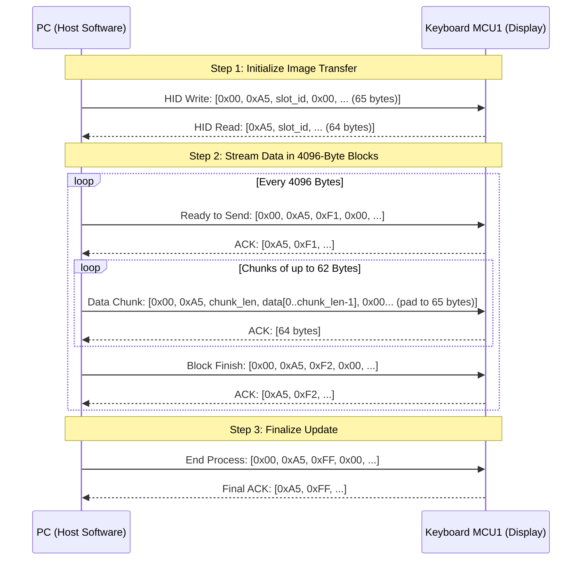

# Turtle Beach Command Series KB7 - USB HID Protocol Specification

## 1. Device Identification & USB Architecture

* **Vendor ID (VID):** `0x10F5` (Turtle Beach / Roccat)
* **Product ID (PID):** `0x5038` (Command Series KB7 Keyboard)
* **USB Hub PID:** `0x503D` (Integrated high-speed USB hub)
* **Storage Mode PID:** `0x5037` (USB Mass Storage for firmware / asset storage)

### Dual-MCU Hardware Architecture
The Turtle Beach KB7 utilizes two microcontrollers to separate real-time gaming input from high-resolution display rendering:
1. **MCU 1 (Display & USB Controller):**
   * **Chipset:** Sonix SNC73xx series (High-speed USB 2.0 + LCD Controller)
   * **Firmware:** `KB7_V1.39.bin`
   * **Graphics Engine:** Embedded **LVGL** (Light and Versatile Graphics Library)
   * **Panel:** 4.3-inch Capacitive Color Touch Display, 800 × 480 WVGA resolution
2. **MCU 2 (Analog Matrix & Hall Effect Switches):**
   * **Chipset:** Artery AT423 / AT32F423 (`AP_AT423_V1.15.bin`)
   * **Function:** High-frequency polling (up to 8,000 Hz), magnetic Hall-effect actuation point scanning, Rapid Trigger, and SOCD resolution.

---

## 2. USB HID Interface Map

| Interface | Collection | Usage Page | Usage | In/Out/Feature Length | Function |
| :--- | :--- | :--- | :--- | :--- | :--- |
| **`mi_00`** | - | `0xFF90` | `0xFF00` | 65 / 65 / 65 bytes | Sonix bootloader ISP & low-level hardware control |
| **`mi_01`** | - | `0xFF00` | `0x0001` | 65 / 65 / 0 bytes | **Display Protocol & Image Data Streaming (LCD)** |
| **`mi_02`** | `COL01` | `0x000C` | `0x0001` | 4 / 0 / 0 bytes | Consumer Media keys (Play, Pause, Vol+, Vol-) |
| **`mi_02`** | `COL02` | `0x0001` | `0x0080` | 2 / 0 / 0 bytes | System Control (Power, Sleep, Wake) |
| **`mi_02`** | `COL03` | `0xFF01` | `0x0001` | 8 / 0 / 0 bytes | Custom Hardware Event Stream 1 |
| **`mi_02`** | `COL04` | `0xFF02` | `0x0001` | 12 / 0 / 0 bytes | **Touch Screen Input & Widget Interaction Events** |
| **`mi_02`** | `COL05` | `0x0001` | `0x0006` | 21 / 0 / 0 bytes | Extra keyboard scan codes / Macro execution |
| **`mi_02`** | `COL06` | `0xFF03` | `0x0001` | 0 / 0 / 1044 bytes | RGB Lighting & Profile Feature Reports |
| **`mi_03`** | - | `0x0001` | `0x0006` | 9 / 2 / 0 bytes | Primary Standard HID Keyboard (8000 Hz polling) |

---

## 3. Display Control & Image Streaming Protocol (`mi_01`)

Communication with the touch display is executed over interface `mi_01` (UsagePage `0xFF00`, Usage `0x0001`).
All packets use **65-byte HID Output Reports** (Byte 0 is Report ID `0x00`, followed by 64 bytes of payload).
The host reads back **64-byte HID Input Reports** as acknowledgments.

### 3.1 Display Frame Specifications
* **Screen Resolution:** 800 × 480 pixels
* **Color Depth:** 16-bit **RGB565** Little-Endian
* **Byte Order:**
  $$\text{pixel}_{16} = ((R \text{ \& } 0\text{xF8}) \ll 8) \mid ((G \text{ \& } 0\text{xFC}) \ll 3) \mid (B \gg 3)$$
  * Byte 0: `pixel & 0xFF` (Low byte)
  * Byte 1: `(pixel >> 8) & 0xFF` (High byte)
* **Total Background Payload Size:** $800 \times 480 \times 2 = 768{,}000\text{ bytes}$

### 3.2 Protocol Sequence Flow

### 3.3 Packet Definitions

#### 1. Start Image Update Command
Sent to begin transmission to a specific screen target:
* **Host Output Report (65 bytes):**
  * `[0]` = `0x00` (Report ID)
  * `[1]` = `0xA5` (Magic command byte)
  * `[2]` = `slot_id`:
    * `0x00`: Full background wallpaper ($800 \times 480$)
    * `0x40`: Scaled background
    * `0x41 + n`: Custom widget icon for slot $n$ ($0 \le n \le 15$)
  * `[3..64]` = `0x00` (Padding)
* **Device Response (64 bytes):**
  * `[0]` = `0xA5`
  * `[1]` = `slot_id` (Echo of command)
  * `[2..63]` = Status bytes

#### 2. Ready to Start Block Command (`0xF1`)
Sent before each 4096-byte data segment:
* **Host Output Report (65 bytes):**
  * `[0]` = `0x00`
  * `[1]` = `0xA5`
  * `[2]` = `0xF1`
  * `[3..64]` = `0x00`
* **Device Response (64 bytes):**
  * `[0]` = `0xA5`
  * `[1]` = `0xF1`

#### 3. Image Data Chunk Packet
Sent repeatedly until 4096 bytes are transmitted (or final block ends):
* **Host Output Report (65 bytes):**
  * `[0]` = `0x00` (Report ID)
  * `[1]` = `0xA5` (Magic byte)
  * `[2]` = `chunk_length` ($1 \le \text{len} \le 62$, default `0x3E` / 62 bytes)
  * `[3 .. 3 + chunk_length - 1]` = Raw RGB565 image bytes
  * `[3 + chunk_length .. 64]` = `0x00` (Padding to 65 bytes total)
* **Device Response (64 bytes):**
  * Acknowledgment report indicating ready for next chunk.

#### 4. End of Block Command (`0xF2`)
Sent after every 4096 bytes:
* **Host Output Report (65 bytes):**
  * `[0]` = `0x00`
  * `[1]` = `0xA5`
  * `[2]` = `0xF2`
  * `[3..64]` = `0x00`
* **Device Response (64 bytes):**
  * `[0]` = `0xA5`
  * `[1]` = `0xF2`

#### 5. End LCD Image Update Command (`0xFF`)
Sent when the entire image stream has completed:
* **Host Output Report (65 bytes):**
  * `[0]` = `0x00`
  * `[1]` = `0xA5`
  * `[2]` = `0xFF`
  * `[3..64]` = `0x00`
* **Device Response (64 bytes):**
  * `[0]` = `0xA5`
  * `[1]` = `0xFF`

---

## 4. Touch Input Protocol (`mi_02`, `COL04`)

When interacting with the 4.3" touch display, touch coordinates and widget clicks are streamed to the host on interface `mi_02`, collection `COL04` (Usage Page `0xFF02`, Usage `0x0001`):

* **Report Length:** 12 bytes
* **Report Structure:**
  * `Byte 0`: Report / Event Type:
    * `0x33`: Widget Tap / Touch Gesture event
    * `0x08`: Raw coordinate update
  * `Byte 1`: Event Sub-Type / Gesture State (Down = `0x01`, Move = `0x02`, Up = `0x00`)
  * `Byte 2`: Active slot or Widget ID
  * `Byte 3..4`: $X$-coordinate (16-bit Little-Endian, $0 \dots 799$)
  * `Byte 5..6`: $Y$-coordinate (16-bit Little-Endian, $0 \dots 479$)
  * `Byte 7..11`: Pressure, velocity, and checksum data
